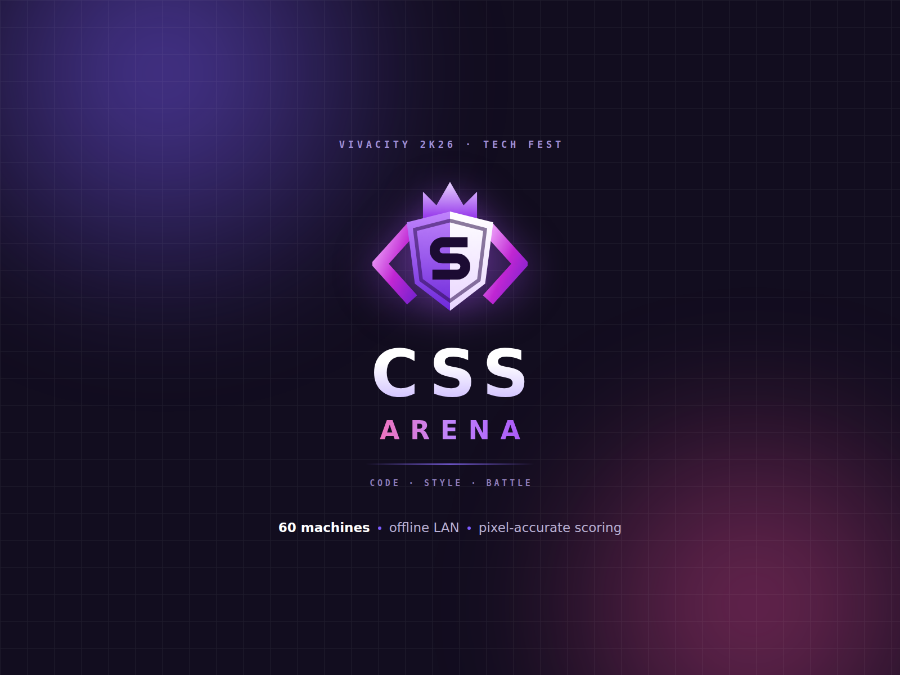
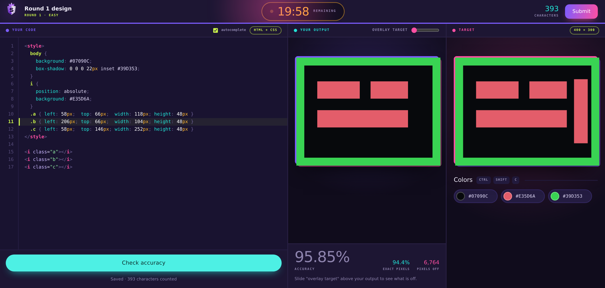

<p align="center">
  
</p>

# CSS Arena

A competition platform for a CSS-golf event — recreate a target design in HTML
and CSS, scored pixel by pixel — built to run **sixty machines on a college LAN
with no internet at all**.

Written for VivaCity 2K26. One host PC runs everything; every other machine
needs nothing but a browser and an address.



## What it does

**For the participant** — register, wait, and the screen switches by itself
when the organiser starts a round. Then a three-pane arena: an editor with
syntax highlighting and autocomplete on the left, your live render in the
middle, the target and its colour palette on the right. Check your accuracy as
often as you like. Submit early or let the clock do it for you.

**For the organiser** — a console locked to the host machine: attach designs,
start a round on every PC at once with a synchronised countdown, watch a live
roster, grant extra time to a machine that died, score the round, publish
standings, confirm who advances, and export the whole event as an Excel
workbook.

## How it works

```
 participant PCs ──HTTP──▶  Apache + PHP  ──▶  MySQL (localhost only)
   (browser only)                │
                                 └──▶ chrome-headless-shell ──▶ PNG ──▶ GD pixel diff
```

- **One shell renders everything.** The target and every submission go through
  byte-identical markup, so a submission can only differ because the code
  differs.
- **Scoring** screenshots the submission, compares it to the target with a
  luminance-weighted colour distance, and rescales the result against a blank
  render of the same design — so an empty submission scores 0%, not 35%.
- **The clock is the server's.** Every screen draws its countdown from a
  timestamp the server sends, so a lab PC with the wrong time still ends on
  time.
- **No WebSockets.** One `api/state.php` poll per second per machine is enough
  for sixty PCs and has nothing to go wrong at the far end.
- **Only the picture ships.** Design source is written into `storage/`, which
  the web server refuses to serve; participants receive the rendered PNG and
  the palette read off it.
- **The admin console is locked three ways:** an Apache `Require ip` rule, a
  PHP allow-list, and a password.

## Layout

```
index.php            registration and waiting room
play.php             the arena
thanks.php           after submitting
results.php          standings            (host only)
admin/               console, designs, scoring, Excel export   (host only)
api/                 state, register, autosave, check, submit
lib/                 shoot · diff · rank · palette · hints · xlsx · state
assets/              css, js (editor, arena, lobby, admin, confetti)
sql/schema.sql       six tables
tests/               Playwright specs driving the real app
docs/                setup, evaluation rules, testing, engineering notes
```

## Running it

See **[docs/setup.md](docs/setup.md)**. In short: XAMPP, enable GD, copy
`config.example.php` to `config.php` and fill in two values, import
`sql/schema.sql` through phpMyAdmin's **SQL** tab, and put
`chrome-headless-shell` where the config expects it.

## Tests

Playwright drives the real pages — registering, typing, submitting, scoring —
against a SQLite stand-in so no MySQL is needed. See
**[docs/testing.md](docs/testing.md)**.

## Documentation

| | |
|---|---|
| [docs/setup.md](docs/setup.md) | Host PC, network, designs, running the event |
| [docs/evaluation-rules.md](docs/evaluation-rules.md) | How entries are scored and ranked |
| [docs/testing.md](docs/testing.md) | The test suite and what each spec proves |
| [docs/decisions.md](docs/decisions.md) | The decisions that were not obvious, and what forced them |

## Built with

PHP 8 · MySQL · vanilla JavaScript, no framework · chrome-headless-shell · GD ·
Playwright. No runtime dependency fetches anything from the internet, by design.
